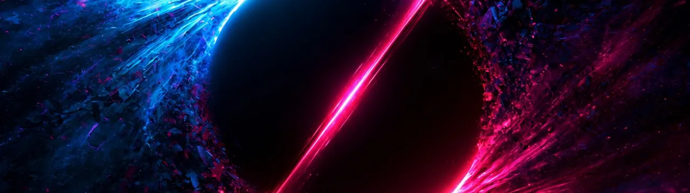

# DARK CONSTELLATION

By Ken Connell



**A turn-based space and drone cybersecurity strategy game, played in a 3D theater.** You are
the mission assurance architect for a smallsat constellation and a drone squadron. An adversary,
COLDVEIL, works on them across 6 nights. You scan for what is coming, place defenses, answer
strikes, and make the call when your own automated defense stops one of your own.

Play it: https://kensden.github.io/dark-constellation/ (the released v1.6 game, until v2.0
merges)

Status: **v2.0, Round 5, in work on the `v2.0/r5` branch** (17 November 2026). This README
describes the game on this branch, which is the 3D game and nothing else: the pixel board it
grew from is retired here, with its screens and its rule set out of the tree. That game is kept
as it was released on `main`, and as it stood on the `v1.7/r1` and `exp/3d-slice` branches.

## How to play

A game is 6 nights. Finish night 6 with the mission assurance score at 70 or above to win. Let it
fall under 35, or let the budget go below zero at a dawn, and the operation ends early.

**Before the night.**

- **Scan.** Tonight's possible moves stand over the fleet as signatures, each with a look of its
  own, each on the asset it would strike. They are unidentified until you scan them, and you have
  2 scan pulses a night. Every signature is also a button in a row at the foot of the screen.
- **Or name it on sight.** Each of the 18 threats has a look of its own, scanned or not. Know the
  look and you can name an unidentified signature from 4 names, the other 3 being moves it is
  easily taken for and none of them on tonight's board. Right, it is identified and no pulse is
  spent, and you may name another; the first wrong name ends naming for the night. The Dossier
  shows every filed card's signature, and NAME THAT SIGNATURE there is the practice round.
- **Place 1 defense.** A defense covers the whole fleet against the moves it answers, and COLDVEIL
  reads it: it takes the move you have covered least. Where you set the piece down matters too.
  The asset your newest defense sits on is the **watch post**, and any strike on that asset lands
  1 point weaker. The piece's card recommends a spot.
- **Order assets**, if the budget allows. More fleet covers more ground, and coverage is 30
  percent of the score.
- **WORST CASE** says what the budget would read tomorrow morning if tonight goes as badly as it
  can, with funding and the coverage bonus in. An order is marked risky, and BEGIN asks twice, only
  when a broken budget is more likely than not by tomorrow night.

**The night.**

- **The tie-break.** On 3 nights of every operation the fleet's policy engine stops one of your
  own drones, satellites or agents because a rule tripped. The card shows what it was doing, the
  rule, and 3 checks. Sometimes the machine is right (the action was compromised) and sometimes it
  is wrong (a false positive that costs the mission). You override the block or let it stand. No
  call in time, and the block stands. The first hold a device meets has no clock, and there is
  none with Assist or Reduce Motion on. Every call is logged, and the debrief lists each one with
  whether it was right and what it cost or kept.
- **Answers.** Each move that would land stops short of its target with its answers beside it:
  block it, halve it, or ride it out. You have **3 answers for the whole operation**, they cost
  no credits, and nothing buys another, so which moves get one is the decision of each night. The
  card shows what else is coming tonight. A defense is the only thing that stops the rest.
- **The timed tap.** As a move that will land closes on its target, a ring closes with it. A tap
  as they meet takes a little off the damage (5 percent at best). It is a bonus only, and Assist
  grants a steady half of it with no timing.
- **The debris call** (night 4 or 5): burn the satellite off the crossing orbit, or hold and take
  the odds.
- **The BLACKOUT CHAIN** (night 6): COLDVEIL's signature move. It jams GNSS so the drones fall
  back on LiDAR, then attacks the only sensor they have left.

**Dawn** closes the night: the score against the win line, what made it move, the budget line by
line, and what to fix. **The debrief** gives a grade from S to F, the tie-breaks, one thing to do
differently NEXT TIME (measured by playing your game again with that one change), a replay of the
nights beside a ghost run, and the Dossier.

Every gesture has a tap in its place. A piece can be dragged onto an asset or placed from its
card; an answer can be dragged onto its target or tapped; the scan lens can be dragged over a
signature or the signature tapped.

## How it is balanced

`npm run sweep` plays 500 seeds a line through the engine and holds the game to these on every
battery run (`tests/sweep.spec.ts`). On STANDARD:

| line | wins |
|---|---|
| Prepared: scans, places the defense that answers the move COLDVEIL favors on the recommended spot, answers each move that would land while it has an answer, reads every hold right | 86.2% |
| Novice: scans the first 2 signatures, places a piece the tray lights for one of them, answers 2 moves in 3, calls 2 holds in 3 right | 39.4% |
| Nothing: no orders, no answers, no calls | 0% |

Reported beside them, and held to no band: the Expert, who is Prepared saving the 3 answers for
moves of 2 points or more, wins 98.4%. That is skill rewarded, and the gate holds every fixed
line under it.

No line that does less than Prepared wins more often than Prepared: not a line that places 2 or 3
defenses and banks the rest, not a drone a night with no defense, not one written order of
defenses, not answers with no orders. Prepared overriding every hold, and Prepared letting every
block stand, each win about 6 points less than Prepared reading the evidence. Prepared placing
its pieces at random wins about 44 points less. A perfect timed tap on every strike lifts the
Novice by about 7 points. Naming every signature on sight lifts Prepared by about 14 points and
the Novice by about 11. Guessing at names (right 1 time in 4, until the first miss ends it) is
held to a gain of 5 points at most, and measures as 0 to 4.

The fleet is not a bank. Through Round 4 Prepared who also ordered a drone a night won all 500: a
drone was 15 CR for 2.7 points of score, with no upkeep. A drone is 25 CR now and the opening
budget 90, so the first drone, the one the first night teaches, leaves what it always left and
each one after it costs 10 more. Prepared with a drone a night as well now wins 26.6%, because
it spends what its defenses need; the same line keeping tomorrow's likely bills in hand wins
80.0%, and 92.6% with the Expert's answers. The gate holds every one of them under the Expert.

**Grades** run S to F. A win is graded on its final score plus a defense bonus, against bands set
from the same sweep so that S is about the top 5 percent of wins and A the next 20, at each
difficulty: on STANDARD, S from 92.0, A from 88.0, B from 78.5; on EASY, where hits do less and
scores run higher, A from 90.6 and B from 80.6. A is the top grade on EASY: S is earned on
STANDARD. A loss that lasted all 6 nights is a D, and one that ended early an F.

## Daily Op, the Dossier and the reading

- **DAILY OP #n.** One mission a day from the title screen, the same for every player whose
  calendar shows that date: FIRST LIGHT on STANDARD, seeded from the local date. The first Daily
  Op you finish on a date is recorded on your device as the official run. Replays that day are
  practice, and so is any Daily Op loaded from a save code, since a code is text anyone can edit.
- **The Dossier.** Every threat with its moving signature. A filed card says where it hit you and
  how often you blocked it, and opens to what stops it, the framework technique and every source.
  NAME THAT SIGNATURE is a round on the cards you have filed.
- **Unlocks** are earned by playing and kept on the device: fleet finishes, a harder COLDVEIL
  posture with 1 scan pulse a night, a second opening. Nothing is sold.

## The mechanics in brief

- **Mission assurance score.** A weighted blend of Coverage, Link availability, Data integrity
  and Sensor integrity. It is the score and the loss condition at once.
- **Active conditions.** GNSS denial, jamming, spoofing, eavesdropping, data leaks and ransomware
  do not resolve and vanish. They persist for a set number of nights, press the score each night,
  and stack.
- **One new defense a night**, each with upkeep in CR every night. Repairs come out of the budget
  at dawn before mission funding arrives.
- **Deployment lead time.** A drone or a ground station arrives at the next dawn, a satellite
  after 2 nights.
- **Human in Command.** The lesson of the tie-break, named once, in the debrief: people write the
  policy, machines enforce it, and a person owns the tie-break. The term is from the European
  Commission High-Level Expert Group on AI's Ethics Guidelines for Trustworthy AI (2019). The
  holds themselves are fiction; the checks on each card are ordinary public practice (a signature
  on an order, a change on file, a firmware image against its seal, an allowlist, a command
  counter that never repeats, where training data came from, a certificate's chain, whether a link
  is encrypted).
- **Difficulty.** EASY scales damage and repair costs by 0.75. STANDARD is the tuned campaign.

## The sourcing promise

Every adversary threat in the deck maps to a published framework technique, and every reference
was checked by hand against its live source page rather than recalled, and the battery re-checks
every link before each deploy: **18 threat events**, **18
distinct framework techniques** across SPARTA, MITRE ATT&CK® and MITRE ATLAS, plus **1 NSA
advisory**, **16 cited sources**, and **0 unverified references**. Each of the **11 countermeasures** maps to
its SPARTA countermeasure controls with their published defense-in-depth tiers (**19 distinct
SPARTA CMs**). The in-game GLOSSARY derives all **51 entries** directly from that content data,
with no hand-maintained text.

SPARTA® is a registered trademark of The Aerospace Corporation. MITRE ATT&CK® and ATT&CK® are
registered trademarks of The MITRE Corporation; MITRE ATLAS™ is a trademark of The MITRE
Corporation. Technique and countermeasure IDs, names and tiers are cited from them for education;
no endorsement is implied. The SPARTA and MITRE ATT&CK copyright designations and license terms
ship with the site at `/legal/THIRD-PARTY-NOTICES.txt`
([public/legal/THIRD-PARTY-NOTICES.txt](public/legal/THIRD-PARTY-NOTICES.txt)).

The **FIELD LIBRARY**, under LIBRARY on the title screen beside the GLOSSARY,
shelves **36 readings** behind the threats: papers, advisories, standards and hands-on
material, each checked against the live page. Every threat's event card links to its own
readings. An entry is stamped FILED once you have met a threat it covers, and general reading
once you have finished a campaign; every entry is open to read either way.

All organizations, vendors, constellations, and threat actors in the fiction are invented. Where
an event is inspired by a real incident, its card cites institutional analysis rather than naming
the people or companies involved; the Field Library links primary sources, including one
operator's own incident report. Only public sources are used.

## Sound and feel

- **Synthesized, not recorded.** Every effect is generated in the browser with Web Audio. No audio
  files ship with the game. Each of the 18 threats has a synthesized voice of its own, under a
  second long, played as its move leaves COLDVEIL: jamming is noise in a band, a spoof is a tone
  with a twin sliding off it, an implant is a heartbeat. The mix is measured, not guessed
  (`scripts/measure-mix.js`, `tests/mix-measurement.json`): the 18 sit within 4 dB of each other
  and under the hit's own sound.
- **A procedural music bed** with layers that follow the campaign: a base pad, a tension layer
  when the score falls below the win line or a condition is active, and a threat layer while a
  BLACKOUT CHAIN is armed or a lost campaign is resolving. It loops by construction.
- **Playable with the sound off.** Nothing in the game is only a sound: every cue has its look,
  and a screen reader hears every signature's look and every card.
- **Reduce Motion, Assist and Low power** are in SYSTEM. Reduce Motion keeps one framing and no
  camera travel. Assist removes the timed tap and the hold's clock. Low power lowers the
  resolution, the particles and the frame rate, and a device that cannot hold 40 frames a second
  is moved to it and told.
- **Haptics** on Chrome-family Android browsers that support vibration. Nothing fires on iPhone,
  by design.

## Tech notes

- React, TypeScript, Tailwind, Vite, and three.js for the theater (one tree-shaken copy, in a
  chunk of its own that the title's hero and the game share). Static build on GitHub Pages.
- **Deterministic engine.** `resolveTurn(state, actions, rng)` is pure: no wall clock, no ambient
  randomness. A seeded PRNG with per-turn streams means the same seed and the same actions always
  produce the same game, which is what makes replays and save codes trustworthy. A committed
  snapshot test guards it.
- **Content is data.** Threats, countermeasures, and scenarios are zod-validated modules. Every
  count shown in the UI derives from that data at build time, and the counts quoted in this README
  are checked against the same data by a test in the battery, so the prose cannot drift from the
  deck.
- **No backend, no telemetry, no analytics, no secrets.** Saves and scores live in your browser's
  local storage. Save codes are portable base64 strings you can paste anywhere. The scoreboard
  and save layers sit behind interfaces so a remote implementation could drop in later, but no
  remote SDK is imported.
- **One rule set.** The pool of answers, the watch post, targets that stay where they were
  sighted, the policy engine's holds and the name on sight (`src/engine/rules.ts`,
  `src/engine/holds.ts`) are the engine's only rules since v2.0 R3. The rules the pixel board was
  released with (a paid intel brief, answers bought with credits) left the engine with it. A save
  from that game is refused as from an earlier version; a save of a 3D game from Round 2 loads.
- **Loaded in pieces.** The title is the first download. three.js is one tree-shaken chunk that
  the title's hero and the game share; the theater, the game, and the game's rooms (the debrief,
  the replay, the Dossier and SYSTEM) each follow as a chunk of their own.
- A validation battery gates every round: typecheck and build, a bundle budget, determinism and
  content tests, the balance sweep, a copy-style scan, a local OPSEC tripwire, and an online link
  check of every cited source.

## Not built yet

Deliberately out of scope, recorded here as future work:

- A remote, shared leaderboard
- A red-teaming crossover scenario, attacking the AI-enabled ground segment

## Credits

I did the design, code, writing, and direction.

**Artwork: AI-generated, human-commanded.** The key art in this README's banner and the link preview
image was generated with AI tools under my direction and selection. The wordmark is set in the DC
Display face, and the game's world (the theater behind the title and under every night, the
fleet, the 18 signatures and their marks) is built in code for this project.

## Releases

- v2.0.0, November 2026: the game in 3D. The pixel board is retired; the same six nights are played in a 3D theater by scanning, placing, answering and calling holds.
- v1.6.2, 29 October 2026: the title screen's desktop layout, curled apostrophes.
- v1.6.1, 27 October 2026: the v1.6.0 deploy fix (size trim, link entry).
- v1.6.0, 27 October 2026: COLDVEIL per seed, the phone night and the playtest passes.
- v1.5.0, 24 October 2026: balance, the leftovers and the art.
- v1.4.0, 24 October 2026: one new defense a night.
- v1.3.0, 23 October 2026: the loop pass. Rounds 0 to 5 went live between 9 and 22 October 2026,
  before the tag.
- v1.2 board rounds, 26 September to 5 October 2026: the cold open, the Daily Op and score
  screen, the Field Library and the wide board (live, not tagged).
- v1.1.0, 23 September 2026: the sound and feel pass.
- v1.0.0, 22 July 2026: first release.

## Licensing

- **Code: copyright 2026 Ken Connell, all rights reserved.** Source, build configuration, tests,
  and tooling are published to be read and reviewed; no license is granted to reuse them. See
  [LICENSE](LICENSE).
- **Artwork and written content: copyright 2026 Ken Connell, all rights reserved.** Unchanged:
  they were never covered by the MIT license.
- **Earlier versions:** the v1.0.0 and v1.1.0 releases and every commit up to and including 26c9ed0
  released their code under the MIT License. That grant still applies to copies of those versions;
  it does not apply to anything added or changed after them. The public history was restarted on
  27 September 2026, so those commits no longer appear in it.
- **Display typeface:** a subset of Press Start 2P by CodeMan38, used under the SIL Open Font
  License 1.1. The license travels with the font at
  [src/ui/assets/fonts/OFL.txt](src/ui/assets/fonts/OFL.txt), and ships with the deployed site at
  `/legal/OFL.txt`. Because subsetting makes it a Modified Version, the bundled binary is renamed
  to the neutral family name `DC Display`; the original copyright and Reserved Font Name notice are
  retained verbatim.
- **Reuse:** to ask about using any of this, open an issue on this repository.

## Development

```
npm install
npm run dev
```

### Validation battery

```
node scripts/battery.mjs
```

Runs typecheck, production build, a bundle budget on everything the build emits (the initial and
deferred code gzipped, static assets raw), the whole test suite (determinism, content,
persistence, the rules, the balance sweep, cues, sound, music, haptics and the DOM suites), a
check that the dev sound board stays out of the build, a copy-style scan, a local OPSEC tripwire,
a phone layout pass in headless Chrome (the title, the reading rooms, and the game's briefing and
first orders, as served and in wide fonts), and the online content link check. Must be green
before a round closes.

The determinism tests replay fixed-seed full games and compare a hash of the event log against
committed values (`tests/determinism.snap.json`, and the 2 hashes in `tests/watch.spec.ts`).
After a deliberate engine or content change, regenerate them with `UPDATE_SNAPSHOTS=1 npx vitest
run` and commit the diff knowingly.

The balance sweep (part of the battery; this prints its table):

```
npm run sweep
```

The game is also played by a bot in a real headless Chrome, by touch at 375x553, 375x667 and
430x932 and with a mouse at 1440x900. It plays whole six-night games, captures every beat, and
checks what a capture cannot show: no page error, every button named and at least 44 px, no text
under 12 px, the dock leaving the world in view, the tray showing whole pieces, the target of a
strike clear of the cards, and the frame rate:

```
npm run build
node scripts/game3d-bot.mjs --out <dir> [--video] [--only <run>]
```

### OPSEC gate (required before pushing)

A pre-push hook scans everything a push would publish: each outgoing commit's tree content, file
paths, commit message, and author identity, plus pushed ref names, tag objects, and the working
tree. Any deny-listed hit blocks the push.

One-time setup after cloning:

```
git config core.hooksPath scripts/hooks
cp .opsec-terms.example .opsec-terms
```

Then edit `.opsec-terms` and add the private deny-list, one term per line. That file is
git-ignored and must never be committed. The hook fails closed: no deny-list, no entries, no push.

Limits: matching is case-insensitive fixed-string over UTF-8 text. Terms of 4 characters or fewer
match on word boundaries only, so short abbreviations do not false-positive inside base64 hashes.
Binary and non-UTF-8 files are not scanned; keep them out of the repo or review them by hand.
