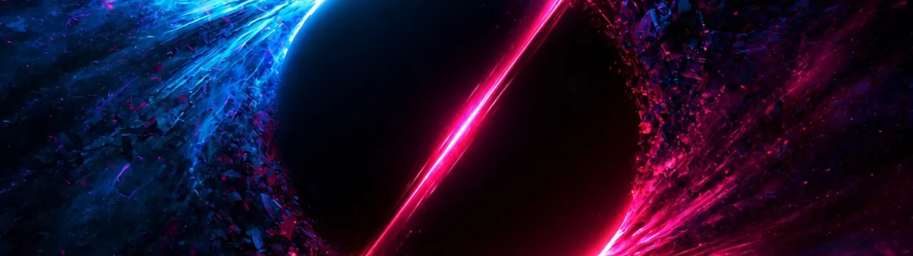

# DARK CONSTELLATION

By Ken Connell



**A turn-based space and drone cybersecurity strategy sim.** You are the mission assurance
architect for a smallsat constellation and a drone squadron. Design and procure the
architecture, defenses included, under budget while an adversary campaign escalates across 6 turns.

Play it: https://kensden.github.io/dark-constellation/

Status: v1.3.0, released 23 October 2026: the loop pass, six turns against a reacting adversary,
with the title and briefing, the board and PROCURE, the night, the debrief, the Dossier and LIBRARY.

## How to play

Each turn you read what COLDVEIL could hit tonight, order fleet and defenses, then EXECUTE and
see what your posture absorbed. The adversary reacts: it takes the move you have covered least.
Finish turn 6 with the mission assurance score at 70 or higher to win; let it collapse, or run the budget
below zero at a turn close, and the operation ends early. There is no dominant strategy: every
defense carries upkeep, repairs come due at the turn close, and coverage, trust, and redundancy
trade off against each other.

## Daily Op and the debrief

- **DAILY OP #n.** One mission a day from the title screen, the same for every player whose
  calendar shows that date: FIRST LIGHT on Standard, seeded from the local date. The first Daily
  Op you finish on a date is recorded on your device as the official run. Replays that day are
  practice, and so is any Daily Op loaded from a save code, since a code is text anyone can edit.
  A run belongs to the date it started on.
- **The debrief.** A grade from S to F, the final mission assurance score, hits taken and budget
  left, and a strip with one square per turn: green when the score held or rose, amber for a drop
  under 3, red for a drop of 3 or more or a lost asset. Share it as a few lines of text through
  your device's share sheet, or the clipboard where there is none.
- **The Dossier.** Every threat you have met, with its framework technique and its sources, as a
  study guide built from your own runs.

## The mechanics in brief

- **Mission assurance score.** A weighted blend of Coverage, Link availability, Data integrity,
  and Sensor integrity. It is the score and the loss condition at once.
- **Active conditions.** GNSS denial, jamming, spoofing, eavesdropping, data leaks, and ransomware do not resolve and
  vanish. They persist for a set number of turns, shown on the board, press the score every
  turn, and stack.
- **The BLACKOUT CHAIN.** The signature move: deny GNSS so the drones fall back to LiDAR
  odometry, then attack the only sensor they have left. Layered sensing blunts it. Single-sensor
  dependence is a vulnerability an adversary can manufacture on demand.
- **The intel brief.** Free on the first night, then ordered each turn: without it the moves
  COLDVEIL is choosing between stay unnamed.
- **Deployment lead time.** Satellites take two turns to reach orbit. Procure ahead of the threat,
  not into it.
- **Upkeep and WORST CASE.** Every defense needs upkeep in CR each turn, and repairs come out of
  the budget at the turn close before funding arrives. The WORST CASE line on the board's dock
  says, before you EXECUTE, whether a bad night could end the operation; tap it for the sum.
- **Defense streak.** Moves blocked in a row and the points your defenses saved add a small bonus
  to the grade.
- **Difficulty.** Easy scales damage and repair costs by 0.75. Standard is the tuned campaign.

## The sourcing promise

Every adversary threat in the deck maps to a published framework technique, and every reference
was checked by hand against its live source page rather than recalled, and the battery re-checks
every link before each deploy: **18 threat events**, **18
distinct framework techniques** across SPARTA, MITRE ATT&CK® and MITRE ATLAS, plus **1 NSA
advisory**, **16 cited sources**, and **0 unverified references**. Each of the **11 countermeasures** maps to
its SPARTA countermeasure controls with their published defense-in-depth tiers (**19 distinct
SPARTA CMs**). The in-game GLOSSARY derives all **51 entries** directly from that content data,
with no hand-maintained text.

SPARTA® is a registered trademark of The Aerospace Corporation. MITRE ATT&CK® and ATT&CK® are
registered trademarks of The MITRE Corporation; MITRE ATLAS™ is a trademark of The MITRE
Corporation. Technique and countermeasure IDs, names and tiers are cited from them for education;
no endorsement is implied. The SPARTA and MITRE ATT&CK copyright designations and license terms
ship with the site at `/legal/THIRD-PARTY-NOTICES.txt`
([public/legal/THIRD-PARTY-NOTICES.txt](public/legal/THIRD-PARTY-NOTICES.txt)).

The **FIELD LIBRARY**, under LIBRARY on the title screen beside the GLOSSARY,
shelves **36 readings** behind the threats: papers, advisories, standards and hands-on
material, each checked against the live page. Every threat's event card links to its own
readings. An entry is stamped FILED once you have met a threat it covers, and general reading
once you have finished a campaign; every entry is open to read either way.

All organizations, vendors, constellations, and threat actors in the fiction are invented. Where
an event is inspired by a real incident, its card cites institutional analysis rather than naming
the people or companies involved; the Field Library links primary sources, including one
operator's own incident report. Only public sources are used.

## Sound and feel

Every state change in a turn is played back beat by beat rather than reported as a block of
results: a threat card lands, a condition attaches to its layer, the score eases to its new
value, and each beat carries its own visual cue and its own sound.

- **Synthesized, not recorded.** Every effect is generated in the browser with Web Audio.
  No audio files ship with the game.
- **A procedural music bed** with layers that follow the campaign: a base pad, a tension layer
  when the score falls below the win line or a condition is active, and a threat layer while a
  BLACKOUT CHAIN is armed or a lost campaign is resolving. It loops by construction, so there is
  no seam. The briefing builds the same bed slide by slide and hands it on to the title or to turn 1.
- **Three toggles, Sound, Music and Motion**, all remembered between visits. Nothing plays until
  your first tap or click.
- **Tapped through.** Every card of the night waits for a tap; there is no SKIP. Reduced motion is
  honored as a motion preference: the sequence still plays, every cue takes its static form,
  and the sound is unchanged.
- **Haptics** on Chrome-family Android browsers that support vibration. Nothing fires on iPhone,
  by design.

## Tech notes

- React, TypeScript, Tailwind, Vite. Static build on GitHub Pages.
- **Deterministic engine.** `resolveTurn(state, actions, rng)` is pure: no wall clock, no ambient
  randomness. A seeded PRNG with per-turn streams means the same seed and the same actions always
  produce the same game, which is what makes replays and save codes trustworthy. A committed
  snapshot test guards it.
- **Content is data.** Threats, countermeasures, and scenarios are zod-validated modules. Every
  count shown in the UI derives from that data at build time, and the counts quoted in this README
  are checked against the same data by a test in the battery, so the prose cannot drift from the
  deck.
- **No backend, no telemetry, no analytics, no secrets.** Saves and scores live in your browser's
  local storage. Save codes are portable base64 strings you can paste anywhere. The scoreboard
  and save layers sit behind interfaces so a remote implementation could drop in later, but no
  remote SDK is imported.
- A validation battery gates every round: typecheck and build, determinism and content tests,
  a copy-style scan, a local OPSEC tripwire, and an online link check of every cited source.

## Not built yet

Deliberately out of scope, recorded here as future work:

- A remote, shared leaderboard
- A red-teaming crossover scenario, attacking the AI-enabled ground segment

## Credits

I did the design, code, writing, and direction.

**Artwork: AI-generated, human-commanded.** The key art was generated with AI tools under my
direction and selection. The constellation frame was authored as original vector work for this
project, the wordmark is set in the DC Display face, and the pixel sprites, icons and briefing
scenes were drawn in code for this project.

## Releases

- v1.3.0, 23 October 2026: the loop pass. Rounds 0 to 5 went live between 9 and 22 October 2026,
  before the tag.
- v1.2 board rounds, 26 September to 5 October 2026: the cold open, the Daily Op and score
  screen, the Field Library and the wide board (live, not tagged).
- v1.1.0, 23 September 2026: the sound and feel pass.
- v1.0.0, 22 July 2026: first release.

## Licensing

- **Code: copyright 2026 Ken Connell, all rights reserved.** Source, build configuration, tests,
  and tooling are published to be read and reviewed; no license is granted to reuse them. See
  [LICENSE](LICENSE).
- **Artwork and written content: copyright 2026 Ken Connell, all rights reserved.** Unchanged:
  they were never covered by the MIT license.
- **Earlier versions:** the v1.0.0 and v1.1.0 releases and every commit up to and including 26c9ed0
  released their code under the MIT License. That grant still applies to copies of those versions;
  it does not apply to anything added or changed after them. The public history was restarted on
  27 September 2026, so those commits no longer appear in it.
- **Display typeface:** a subset of Press Start 2P by CodeMan38, used under the SIL Open Font
  License 1.1. The license travels with the font at
  [src/ui/assets/fonts/OFL.txt](src/ui/assets/fonts/OFL.txt), and ships with the deployed site at
  `/legal/OFL.txt`. Because subsetting makes it a Modified Version, the bundled binary is renamed
  to the neutral family name `DC Display`; the original copyright and Reserved Font Name notice are
  retained verbatim.
- **Reuse:** to ask about using any of this, open an issue on this repository.

## Development

```
npm install
npm run dev
```

### Validation battery

```
node scripts/battery.mjs
```

Runs typecheck, production build, a bundle budget on everything the build emits (the initial and
deferred code gzipped, static assets raw), the whole test suite (determinism, content,
persistence, director, cues, reading diet, sound, music, haptics and the DOM suites), a check that
the dev sound board stays out of the build, a copy-style scan, a local OPSEC tripwire, and the
online content link check. Must be green before a round closes.

The determinism test replays fixed-seed full games on Standard difficulty and compares a hash of
the event log against the committed snapshot in `tests/determinism.snap.json`. After a deliberate
engine or content change, regenerate it with `UPDATE_SNAPSHOTS=1 npx vitest run` and commit the
diff knowingly.

Balance sweeps (not a pass/fail gate):

```
npm run sweep
```

### OPSEC gate (required before pushing)

A pre-push hook scans everything a push would publish: each outgoing commit's tree content, file
paths, commit message, and author identity, plus pushed ref names, tag objects, and the working
tree. Any deny-listed hit blocks the push.

One-time setup after cloning:

```
git config core.hooksPath scripts/hooks
cp .opsec-terms.example .opsec-terms
```

Then edit `.opsec-terms` and add the private deny-list, one term per line. That file is
git-ignored and must never be committed. The hook fails closed: no deny-list, no entries, no push.

Limits: matching is case-insensitive fixed-string over UTF-8 text. Terms of 4 characters or fewer
match on word boundaries only, so short abbreviations do not false-positive inside base64 hashes.
Binary and non-UTF-8 files are not scanned; keep them out of the repo or review them by hand.
